

# **Danbaidong Render Pipeline**

## Announcement

Just add something I need.

`DanbaidongRP` is a custom render pipeline built based on `Universal RP 17.0.3`, `Unity 6 (6000.0.30f1)`. This pipeline is optimized for both PBR and NPR Toon Rendering, offering enhanced flexibility for various rendering needs. Future updates will include additional features tailored to my specific requirements.

---

# Tide 工程定制：17.5 对齐终局（2026-10-22 定案，本节为工程侧唯一权威文档）

> **此次对齐（2026-10-22）是本工程最后一次改动渲染管线；此后不再做任何 URP/DBDRP 版本升级。**
> 本节取代已删除的《DBDRP版本契约.md》。版本契约检查器仍在：菜单 `Tide/Dbdrp/检查版本契约`（Ctrl/Cmd+Shift+D，`Assets/Editor/DbdrpContractCheck.cs`，判据已随终局翻转）。

## 对齐终态

- 底座：Unity 6000.5.10f1；本包 = DanbaidongRP（URP 17.0.3 血统 fork）整包顶替官方 URP，**Deferred 模式**。
- 2026-10-22 按方案 A 完成渲染层编码对齐并**经用户确认修复**（D3D12 延迟光照恢复正常）：GBuffer 槽位保持 fork 布局（MRT0-3 + 渲染层@MRT4、无深度切片、`RenderPassEnabled` 恒关、`UseFramebufferFetch=false`），**渲染层编码全面 uint**。

## GBuffer ABI 四组（同进同退，检查器把关）

| 组 | 文件 | 终态 |
|---|---|---|
| ① 写出端 | `Shaders/LitGBufferPass.hlsl` = 17.5（`PackGBuffersBRDFData`）；其余家族（SimpleLit / BakedLit / Unlit / ComplexLit / Terrain / Particles / Nature 及其 GBuffer pass）**有意保留 fork 17.3**，经 `ShaderLibrary/UnityGBuffer.hlsl` 兼容层同样写出 uint | 渲染层一律 uint 写 |
| ② 分配端 | `Runtime/DeferredLights.cs`（fork 主链，勿动）+ `Runtime/RenderingLayerUtils.cs` `GetFormat()` | `R8_UInt / R16_UInt / R32_UInt` |
| ③ 读取端 | `Shaders/Lighting/DeferredLighting.compute` | `TYPED_TEXTURE2D_X(uint4, _GBuffer4)` 直取 `.x`（不走 ×255+0.5） |
| ④ 宏与槽位 | `ShaderLibrary/GBufferCommon.hlsl`（17.5 槽位宏）+ `UnityGBuffer.hlsl`（fork 兼容层，uint 写 + `kMaterialFlagUseBakedGI=16` 保留）+ `ShaderLibrary/GBufferOutput.hlsl`（17.5 + fork 衍生：`LIGHTMAP_ON → UseBakedGI` 位写入） | uint；UseBakedGI 位保留 |

事故记忆（这张表存在的原因）：2026-10-22 之前 ①曾单边升 17.5 而 ②③④仍为 17.3（float/UNorm）→ 渲染层解码为 0 → 光层闸门 `IsMatchingLightLayer` 恒 false → D3D12 下全部方向光被跳过（"纯色不受光"）。**改任何一组前先跑契约检查；四组永远同批一起动。**

## 自研层（工程能力入口，同样禁止以上游版本覆盖）

- **HQF Bloom**：`PostProcessing/**` + Volume `Bloom.highQualityFiltering`
- **屏幕空间光追阴影**：Volume `Shadows.rayTracing` → `ScreenSpaceDirectionalShadowsPass`（屏幕空间 ray-march，非硬件 RT）
- **SSR**：Volume `ScreenSpaceReflection` → `ScreenSpaceReflectionPass`
- ShadowScatter / GPU 光列表 Cluster Deferred / Character Forward：`Runtime/Lighting/**`、`Runtime/Lights/**`、`Shaders/Lighting/DeferredLighting.compute` 等 fork 自研件

## 维护口径（取代旧"升级 playbook"——升级通道已关闭）

1. **不再升级**：URP/DBDRP 版本演进到 2026-10-22 为止；上游 DanbaidongRP / Unity 新版本一律不合并、不 cherry-pick。
2. 其余写出端保持 fork 17.3 是**定案不是待办**；如未来确需动 GBuffer 相关文件：四组同批改、先过契约检查、DX12 编辑器肉眼确认光影，并经用户确认。
3. 任何渲染改动后的验收闸门：契约检查 PASS + Console 零 `Shader error` + DX12 编辑器光影肉眼确认（注意：私有相机/探针球的合成帧不能作为光照判据，改光必须过真实帧）。
4. 回滚锚点（git 哈希）：`f4e6a2a8` = 17.5 shader 取源；`27821ca4` = fork 17.3 基线；`585e618d` = 真 17.5 C# 取源（`RenderingLayerUtils` 等）。
5. 已知残留：`UniversalRendererRenderGraph.cs` 的 Forward 清理路径（约 :844 无条件 `OnCameraCleanup`）在纯 Forward 管线场景（如 Crest Examples）会 NRE——Deferred 主链零影响，遇到再重放补丁，不视为升级事项。

## 事故索引（节选）

| 日期 | 事 | 处置 |
|---|---|---|
| 2026-10-18 | D3D12 包内 Lit"深蓝平板" | 临时钉 D3D11 出包（PC 包现为 D3D11） |
| 2026-10-22 | D3D12 延迟不受光（ABI 四组错配定性） | LitGBufferPass 钉回 17.3 应急 → 同日方案 A 终局对齐（uint 编码 + 17.5 Lit 写出端），用户确认修复 |

---

Subscribe:

* https://space.bilibili.com/39694821
* https://www.zhihu.com/people/danbaidong1111

Roadmap & Features:

- [x] PBR Toon Shader
- [ ] Cel shading
- [x] Danbaidong Shader GUI
- [x] PerObjectShadow
- [x] PCSS/PCF Soft Shadows
- [x] Shadow Scattering
- [x] Ray Tracing Shadow
- [ ] Transparent Shadows
- [x] Toon Toonmapping
- [x] Toon Bloom
- [x] Visual Sky
- [x] High Quality SSR (Ray Tracing)
- [ ] High Quality SSAO
- [ ] High Quality SSGI
- [x] Cluster Deferred lighting
- [x] Character Forward lighting
- [ ] Atmosphere Fog
- [ ] Idol Live アイドル!!!!!

# Usage

* Create a new Unity 6 URP project (6000.0.30f1).
* *Window -> Package Manager*, remove *Universal RP* and delete the contents of the *Assets/Settings* folder.
* Add *DanbaidongRP* through the *Package Manager*. It is recommended to use the "Install package from disk..." option to individually add the [Core](https://github.com/danbaidong1111/DanbaidongRPCore), [Config](https://github.com/danbaidong1111/DanbaidongRPConfig), and [DanbaidongRP](https://github.com/danbaidong1111/DanbaidongRP) packages (select the `package.json` file for each).
* In the *Settings* directory, recreate the DanbaidongRP Asset by right-clicking and selecting *Create -> Rendering -> Danbaidong RP Asset and Renderer*. Then, in *Edit -> Project Settings -> Graphics*, set the *Default Renderer Pipeline* to the pipeline Asset you just created. The scene should now render correctly.
* Next, restart the project. A Wizard window will pop up, which contains the necessary configurations for the pipeline to use correctly.

# Documents

[DanbaidongRP Documents](https://miusjun13qu.feishu.cn/docx/EXPtdrNmnox8hkx4mnCcy8QNn2b?from=from_copylink) (CN)

# Character Rendering

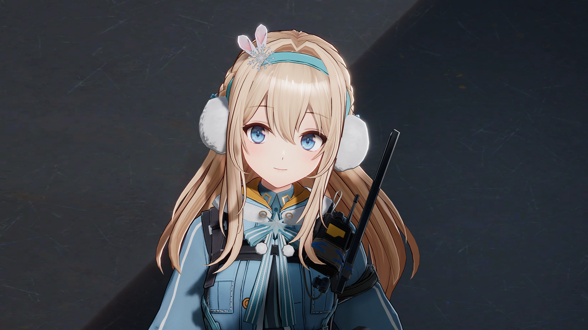

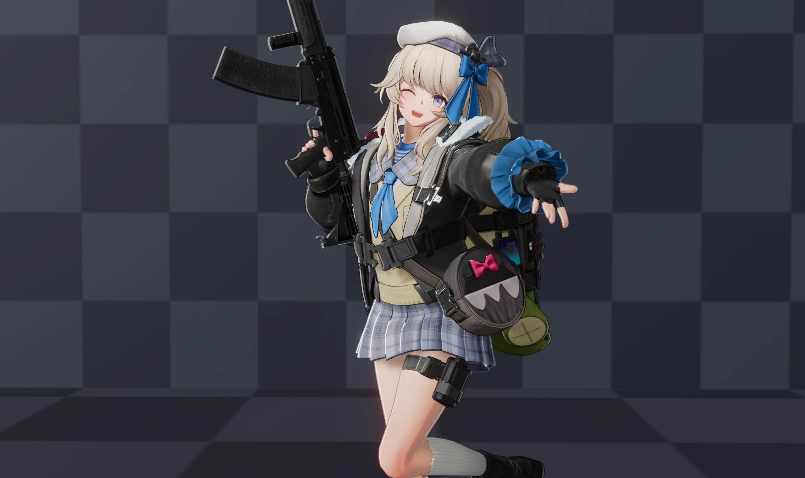

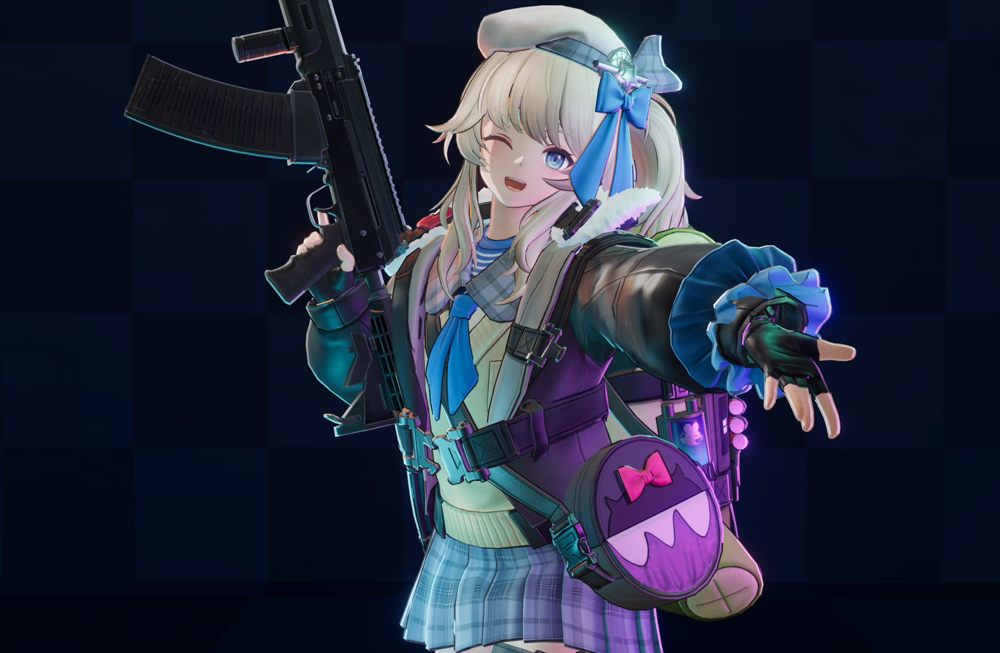

# Danbaidong Shader GUI

CustomEditor "UnityEditor.DanbaidongGUI.DanbaidongGUI"`

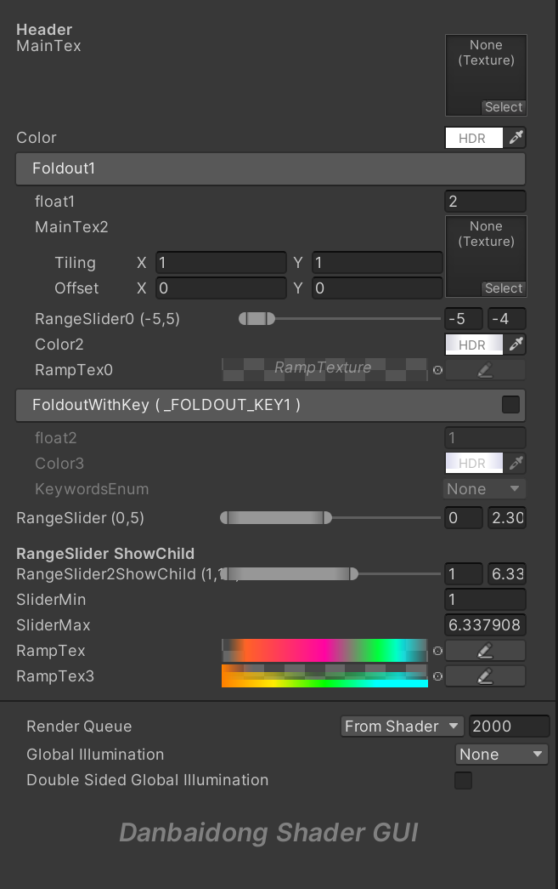

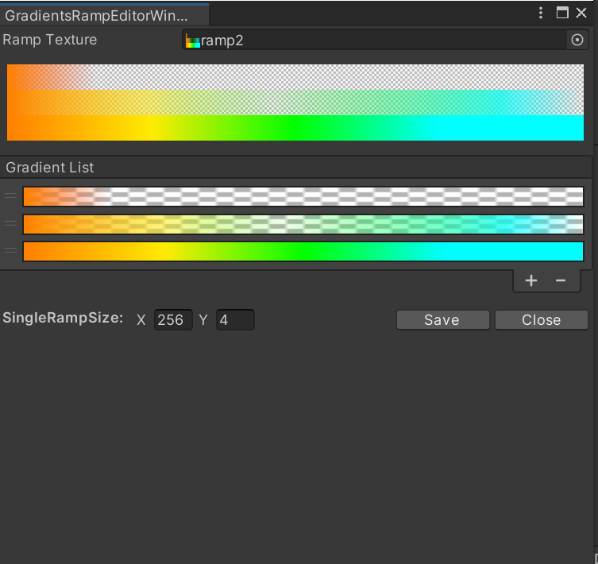

# Shadows

**Shadow Scattering**

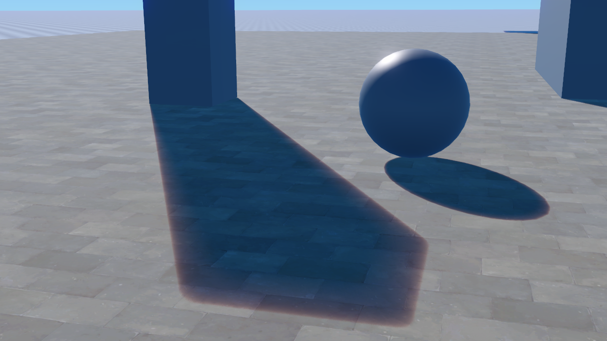

**Per Object Shadow**

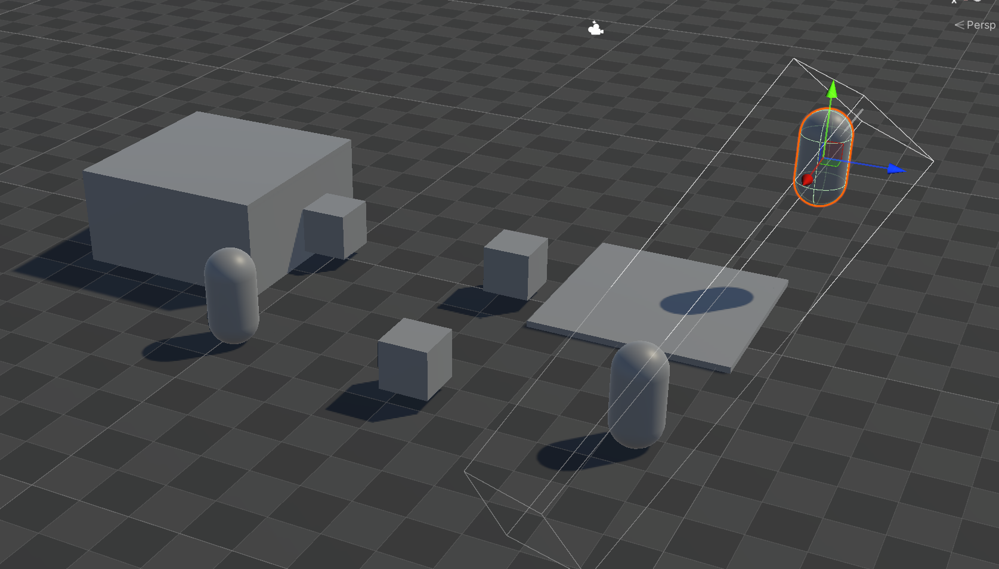

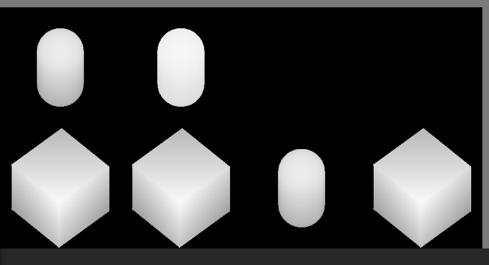

# Reflections (RayTracing)

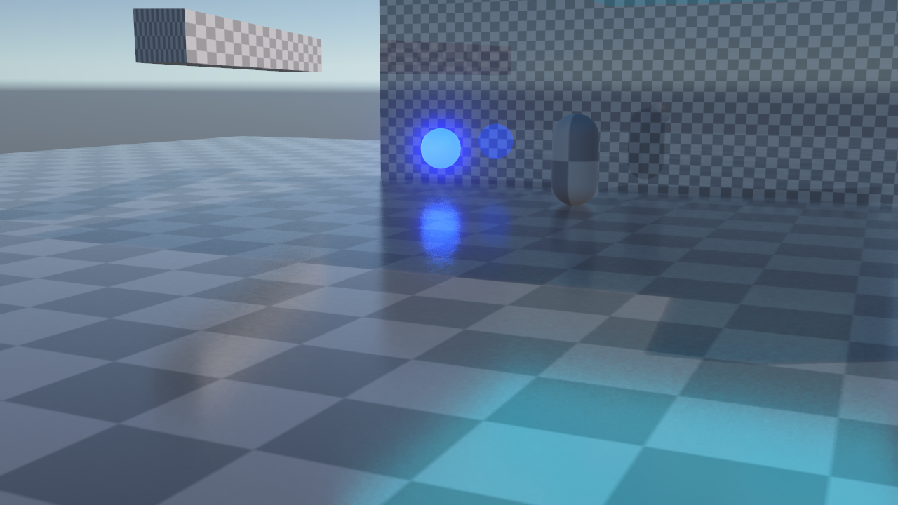

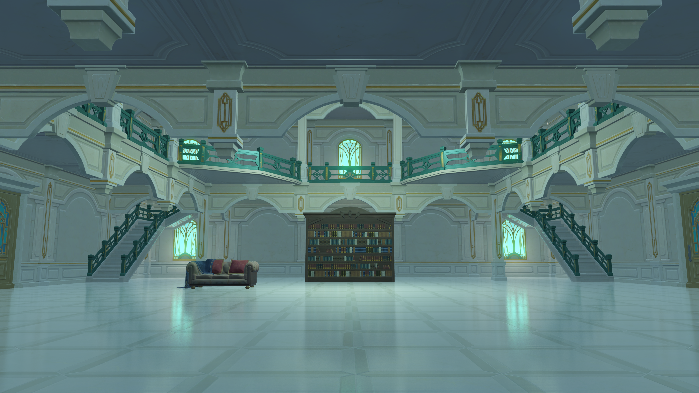

# GPU Lights (Cluster)

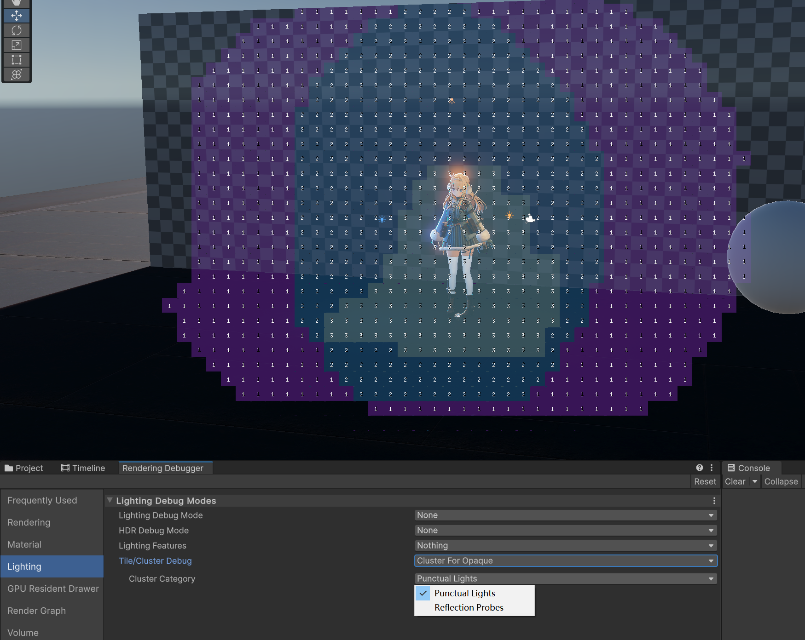

# Others

 
<table><tr><td valign="top" width="50%">

